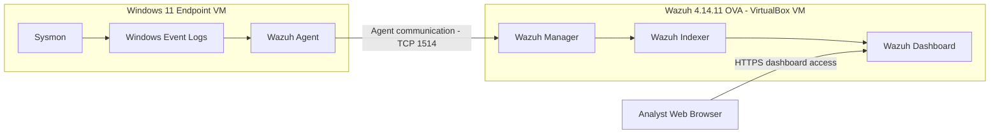

# Home SOC Lab – Wazuh SIEM & Windows Sysmon

A hands-on home Security Operations Center (SOC) lab built to learn and demonstrate endpoint monitoring, log collection, security event analysis, threat detection, and incident investigation using Wazuh and Windows Sysmon.

## Current Lab Status

**Deployment:** Lab environment deployed and initial endpoint integration completed.  
**SIEM platform:** Wazuh 4.14.11 all-in-one OVA running as a virtual machine in Oracle VirtualBox.  
**Endpoint:** Windows 11 with Wazuh Agent and Sysmon installed.  
**Agent status:** Endpoint agent `WIN11-SOC-LAB` is connected and showing **Active** in Wazuh.  
**Validated locally:** Sysmon Operational channel is present and a Process Create event (Event ID 1) has been generated and verified on Windows.  
**Next validation:** Confirm the Sysmon event is searchable in the Wazuh dashboard, then develop and test detection and investigation use cases.

> This is a personal learning lab. Events and scenarios are generated in an isolated test environment and are not production monitoring.

## Architecture

The lab uses two virtual machines:

1. **Wazuh SIEM VM** – Wazuh 4.14.11 OVA deployed in VirtualBox. The all-in-one appliance provides the Wazuh Manager, Wazuh Indexer, and Wazuh Dashboard.
2. **Windows 11 endpoint VM** – Runs the Wazuh Agent and Sysmon. The agent forwards endpoint telemetry to the Wazuh Manager.

### Event flow

1. Sysmon records endpoint activity, including process creation.
2. Windows Event Logs store the generated telemetry in the Sysmon Operational channel.
3. The Wazuh Agent collects the configured Windows event channel.
4. The agent sends collected events to the Wazuh Manager over TCP port 1514.
5. The Manager analyses events and forwards indexed data to the Wazuh Indexer.
6. The analyst accesses the Wazuh Dashboard through a web browser to search, review, and investigate events.

**Wazuh VM address observed during setup:** `192.168.0.111`  
**Agent name:** `WIN11-SOC-LAB`

## Technologies

| Technology | Purpose |
|---|---|
| Wazuh 4.14.11 OVA | SIEM platform: Manager, Indexer, Dashboard |
| Oracle VirtualBox | Hosts the lab virtual machines |
| Windows 11 | Monitored endpoint |
| Wazuh Agent | Collects and forwards endpoint telemetry |
| Microsoft Sysmon | Captures detailed Windows system activity |
| Windows Event Logs | Source of endpoint security and operational events |
| MITRE ATT&CK | Framework for classifying attacker techniques |
| XML | Wazuh agent configuration and detection-rule format |
| Python | Future security automation and analysis exercises |

## Repository Modules

| Module | Documentation |
|---|---|
| SOC Architecture | [Lab architecture](architecture/lab-architecture.md) |
| Sysmon Event Analysis | [Event analysis](sample-logs/sysmon-event-analysis.md) |
| Authentication Monitoring | [Multiple failed logins](investigation-reports/multiple-failed-logins.md) |
| Detection Engineering | [Detection rules](detection-rules/README.md) |
| PowerShell Investigation | [Suspicious PowerShell case study](investigation-reports/suspicious-powershell.md) |
| MITRE ATT&CK | [Technique mapping](mitre-mapping/attack-techniques.md) |
| Incident Response | [PowerShell incident report](incident-response/powershell-incident-report.md) |
| Vulnerability Management | [Vulnerability assessment](vulnerability-management/vulnerability-assessment.md) |
| Security Skills | [Learning outcomes](security-skills/learning-outcomes.md) |

## Completed Setup Milestones

- [x] Deployed Wazuh 4.14.11 OVA in VirtualBox.
- [x] Started and accessed the Wazuh dashboard through a web browser.
- [x] Installed the Wazuh Agent on the Windows 11 endpoint.
- [x] Confirmed agent `WIN11-SOC-LAB` is connected and Active.
- [x] Installed Sysmon and verified the Sysmon Operational event channel.
- [x] Configured Wazuh agent collection for the Sysmon event channel.
- [x] Generated and verified a Sysmon Process Create event (Event ID 1) on Windows.

## Next Steps

- [ ] Verify Sysmon events are searchable in the Wazuh dashboard.
- [ ] Review and validate event collection and indexing.
- [ ] Enable and validate event archiving where appropriate.
- [ ] Build and test detection rules for selected endpoint behaviours.
- [ ] Map detections to MITRE ATT&CK.
- [ ] Document investigation findings and incident response steps.

## Learning Objectives

- Understand SIEM architecture and endpoint-to-SIEM event flow.
- Configure and monitor Windows endpoints using Wazuh Agent.
- Collect and analyse Sysmon telemetry.
- Investigate suspicious process and authentication activity.
- Develop and validate security detection rules.
- Map observed behaviours to MITRE ATT&CK.
- Practise SOC triage, investigation, and documentation.

## Disclaimer

This repository documents a personal cybersecurity learning environment. The lab is not a production SOC, and a locally generated event is not considered a validated Wazuh detection until it is confirmed in the dashboard and investigated.
