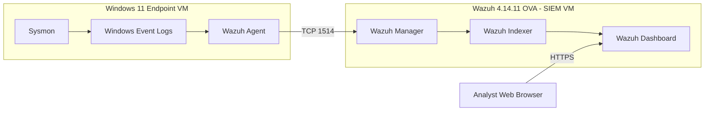

# Home SOC Lab Architecture

## 1. Overview

This lab uses a two-VM design to collect Windows endpoint telemetry and analyse it through Wazuh SIEM. The Wazuh all-in-one OVA runs the SIEM services, while a separate Windows 11 VM acts as the monitored endpoint.

## 2. Deployment Architecture

### Virtual machines

| VM | Platform | Components | Role |
|---|---|---|---|
| SIEM VM | Wazuh 4.14.11 OVA on Oracle VirtualBox | Wazuh Manager, Wazuh Indexer, Wazuh Dashboard | Central collection, analysis, indexing, and visualisation |
| Endpoint VM | Windows 11 on Oracle VirtualBox | Wazuh Agent, Sysmon, Windows Event Logs | Generates and forwards endpoint telemetry |

The OVA provides the Wazuh Manager, Indexer, and Dashboard as an all-in-one appliance. The dashboard is accessed from a web browser; it is not a separate Windows application.

## 3. Logical Data Flow

## 4. Component Responsibilities

| Component | Responsibility |
|---|---|
| Sysmon | Records detailed Windows activity, such as process creation |
| Windows Event Logs | Stores events in channels such as Sysmon/Operational |
| Wazuh Agent | Reads configured event channels and forwards events to the Manager |
| Wazuh Manager | Receives and analyses endpoint events using decoders and rules |
| Wazuh Indexer | Stores and indexes event data for searching |
| Wazuh Dashboard | Provides the browser-based interface for monitoring and investigation |

## 5. Communication

- The Windows endpoint's Wazuh Agent communicates with the Wazuh Manager over TCP port **1514**.
- The Manager, Indexer, and Dashboard communicate within the Wazuh appliance.
- The analyst opens the Dashboard in a web browser over HTTPS.
- The Wazuh VM address observed during this lab setup is `192.168.0.111`. This address may change if the VM network configuration or DHCP lease changes.

## 6. Current Implementation Status

| Item | Status |
|---|---|
| Wazuh 4.14.11 OVA deployed in VirtualBox | Completed |
| Wazuh Dashboard opened in browser | Completed |
| Windows 11 endpoint prepared | Completed |
| Wazuh Agent installed | Completed |
| Agent `WIN11-SOC-LAB` connected and Active | Verified |
| Sysmon installed | Completed |
| Sysmon Operational channel verified | Verified |
| Sysmon Process Create Event ID 1 generated on Windows | Verified locally |
| Sysmon event confirmed in Wazuh Dashboard | Pending |
| Event archiving and detection validation | Pending |

## 7. Initial Event Validation

A Sysmon Process Create event (Event ID 1) was generated and verified on the Windows endpoint. The Wazuh Agent was configured to collect the Sysmon Operational channel and was observed connecting to `192.168.0.111:1514/tcp`.

The next validation step is to locate the generated event in the Wazuh Dashboard. Until that is confirmed, local event generation should not be described as a successful end-to-end SIEM detection.

## 8. Planned SOC Use Cases

- Suspicious PowerShell execution
- Multiple failed authentication attempts
- Process creation monitoring
- Suspicious network connections
- Endpoint security event analysis

## 9. Investigation Workflow

1. Identify an event or alert in the Wazuh Dashboard.
2. Review timestamp, endpoint, user, process, and event details.
3. Determine whether the activity is expected or suspicious.
4. Correlate relevant events and assess severity.
5. Map applicable behaviour to MITRE ATT&CK.
6. Document findings, containment considerations, and recommended remediation.

## 10. Lab Scope and Disclaimer

This is a personal learning environment, not a production SOC. Detection use cases are planned learning exercises; they should only be marked as implemented after the relevant events and rules have been tested and validated in the lab.
